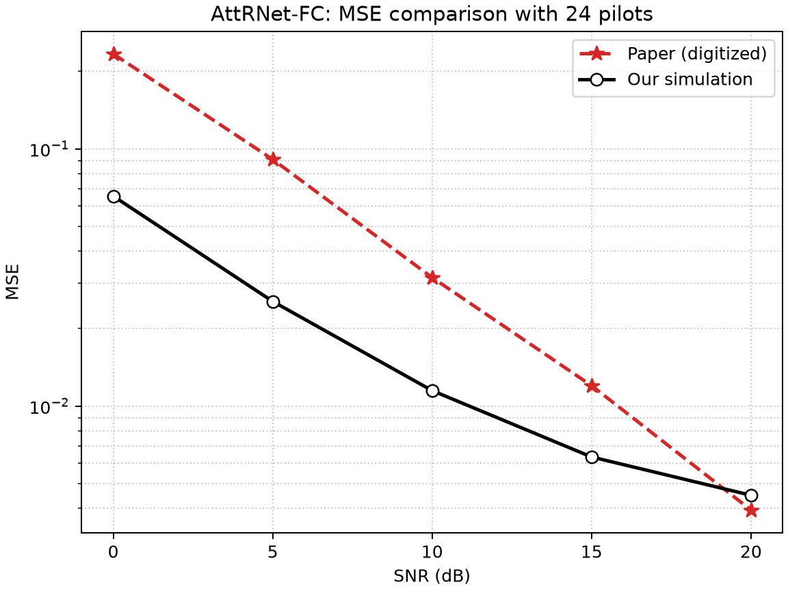
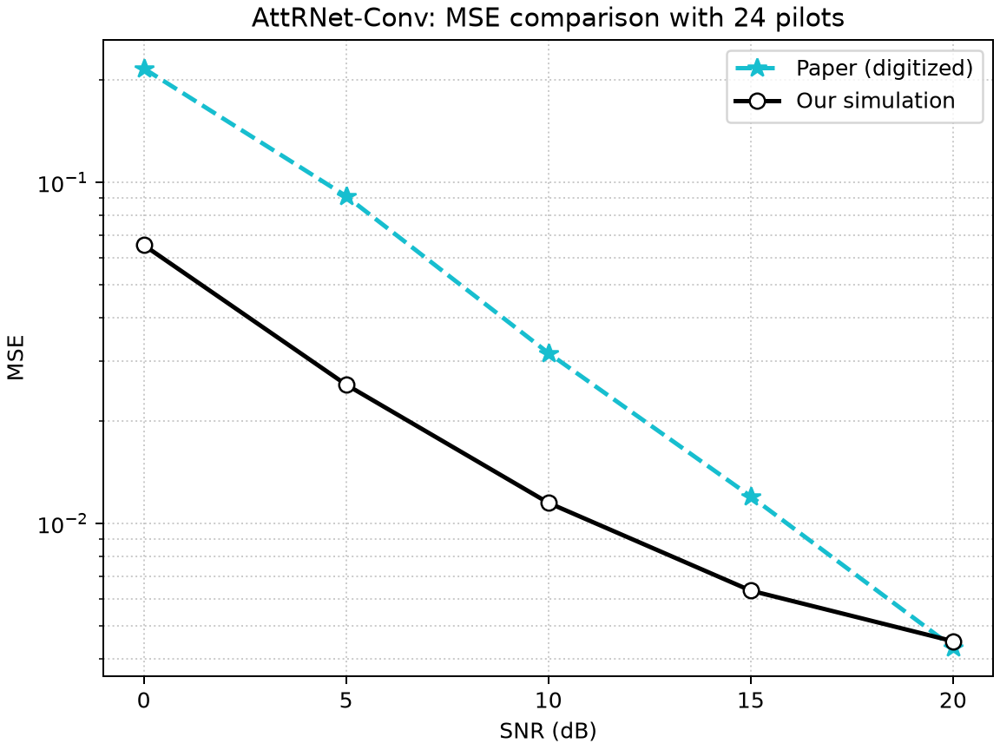
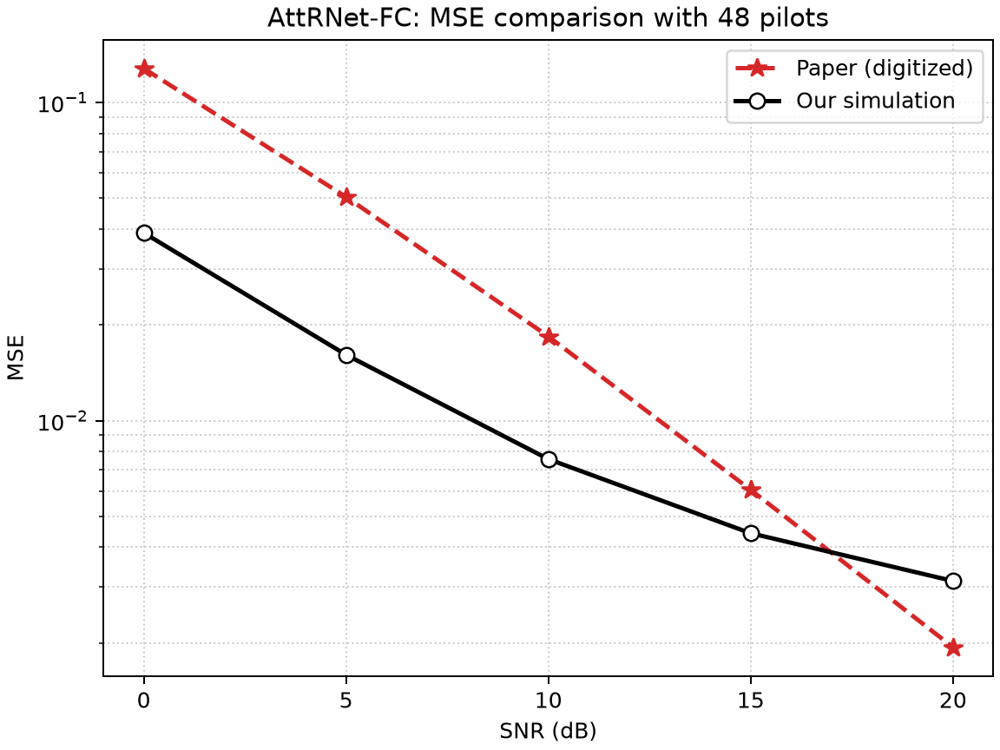
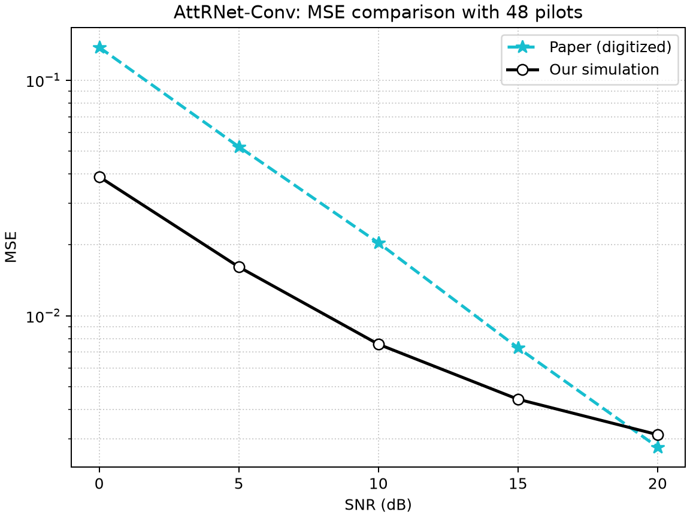

# Deep Learning Based Channel Estimation for OFDM

This project reproduces the AttRNet-Conv and AttRNet-FC channel estimators from Gao et al., *Deep Residual Learning With Attention Mechanism for OFDM Channel Estimation*. It builds MATLAB EPA-OFDM datasets, trains PyTorch models, and compares test-set MSE against approximate values digitized from the paper's plots.

## Progress so far

### AttRNet baseline

The baseline has been trained and evaluated for both attention variants at both pilot counts. The runs use the MATLAB-generated EPA datasets, 100 epochs, Adam with learning rate 0.001, batch size 128, and eight feature channels.

| Pilots | Model | 0 dB | 5 dB | 10 dB | 15 dB | 20 dB |
| ---: | --- | ---: | ---: | ---: | ---: | ---: |
| 24 | AttRNet-FC | 0.0655015 | 0.0255193 | 0.0114817 | 0.00633771 | 0.00449757 |
| 24 | AttRNet-Conv | 0.0655018 | 0.0255239 | 0.0114855 | 0.00634923 | 0.00451102 |
| 48 | AttRNet-FC | 0.0389337 | 0.0161118 | 0.00757006 | 0.00442765 | 0.00313416 |
| 48 | AttRNet-Conv | 0.0389175 | 0.0161130 | 0.00756809 | 0.00442008 | 0.00312695 |

These are test MSE values from the saved runs in `runs/corrected_*`. The expected trend is present: MSE decreases as SNR increases, and the 48-pilot models perform better than the corresponding 24-pilot models. FC and Conv attention perform similarly for a fixed pilot count.

The values are below the paper's approximate digitized values at 0–15 dB and above them at 20 dB for all four configurations. The paper values are readings from Figures 5–6, not tabulated source data. This remaining mismatch is a replication discrepancy, not evidence of improved performance. The original authors' dataset and exact pilot locations are unavailable, and simulation, noise, target, and preprocessing details may differ. See [`paper_vs_simulation_metrics.csv`](paper_vs_simulation_metrics.csv) for the point-by-point reference, relative differences, and checkpoint paths.

#### MSE-versus-SNR plots

Each plot compares the paper's digitized MSE values (dashed) with this project's test-set MSE (solid) at each SNR.

**24 pilots — AttRNet-FC**



**24 pilots — AttRNet-Conv**



**48 pilots — AttRNet-FC**



**48 pilots — AttRNet-Conv**



### Pilot-overhead study

The October 2026 mid-semester presentation reports preliminary comparisons of comb, uniform, block, staggered, and lattice pilot arrangements. Its reported observations are that uniform placement gives the lowest MSE among the tested 24-pilot patterns over most SNRs, and 16 uniformly placed pilots outperform the tested 24-pilot block and comb patterns in the shown results. These are preliminary presentation results; their per-SNR data and generation scripts are not currently included in this repository.

The current checked-in dataset and training scripts still implement only the two baseline uniform rectangular grids: 24 pilots (6 frequency positions × 4 time positions) and 48 pilots (12 × 4). They do not yet reproduce the alternative patterns or 16-pilot result. Pilot-location comparisons should use matched SNRs, data splits, and training settings.

### Next work

- Integrate and validate the different pilot counts and placements in the codebase, then report MSE/NMSE versus SNR and pilot overhead.
- Design and benchmark a lightweight residual Transformer with time-frequency position information against AttRNet using matched conditions.
- Explore the proposed IRS-assisted OFDM extension, including cascaded-channel estimation and IRS phase configuration.
- Compare estimation accuracy alongside parameter count, FLOPs, and inference time.

These are planned directions, not features implemented by the current scripts.

## Model and data

The model takes real and imaginary LS pilot estimates as two input channels and predicts the full 72 × 14 complex channel grid. Each attention block uses global average pooling to summarize learned convolution feature maps and produces one attention weight per feature channel; these weights do not correspond directly to individual pilot positions.

The implementation uses a stem convolution, three attention residual blocks, a 3 × 3 feature convolution, bilinear upsampling, and a 36 × 7 output convolution. The paper does not specify padding for the final layer, so this implementation uses same-size asymmetric padding to preserve the 72 × 14 output. AttRNet-FC uses fully connected attention excitation layers; AttRNet-Conv uses 1 × 1 convolutional excitation layers.

The current eight-feature implementation has 10,254 trainable parameters, including the post-block 3 × 3 feature convolution. The mid-semester presentation lists 9,670; reconcile the parameter-count convention and whether that feature convolution was included before using that figure as a paper-matched count.

The MATLAB dataset generator uses `lteFadingChannel` with the 3GPP EPA 7-path profile, 2.5 GHz carrier, 50 km/h motion, and derived maximum Doppler of about 115.82 Hz. Each pilot-count dataset has 20,000 samples split into 12,000 training, 4,000 validation, and 4,000 test samples. SNRs 0, 5, 10, 15, and 20 dB are equally allocated. Pilot coordinates and equal SNR allocation are explicit reproduction choices because the paper does not disclose them.

For details of the generated arrays and assumptions, see [`DATA_GENERATION_README.md`](DATA_GENERATION_README.md) and [`matlab/README.md`](matlab/README.md).

## Run the baseline

From this directory, activate a Python environment with the packages in `requirements.txt`. MATLAB datasets and imported NumPy splits are already present in this workspace. To generate datasets again, follow the MATLAB instructions in [`matlab/README.md`](matlab/README.md), then import them with `import_matlab_dataset.py`.

Train each baseline configuration:

```powershell
python train.py --model fc --pilots 24 --data-dir data/matlab_epa7_24pilots --epochs 100 --output runs/corrected_fc_24
python train.py --model conv --pilots 24 --data-dir data/matlab_epa7_24pilots --epochs 100 --output runs/corrected_conv_24
python train.py --model fc --pilots 48 --data-dir data/matlab_epa7_48pilots --epochs 100 --output runs/corrected_fc_48
python train.py --model conv --pilots 48 --data-dir data/matlab_epa7_48pilots --epochs 100 --output runs/corrected_conv_48
```

Evaluate a checkpoint on the held-out test set and update the CSV. Repeat with each checkpoint and its matching data directory:

```powershell
python evaluate.py --checkpoint runs/corrected_fc_24/best.pt --data-dir data/matlab_epa7_24pilots --split test --comparison-csv paper_vs_simulation_metrics.csv
```

Evaluation prints overall and per-SNR MSE and saves a paper-style log-MSE comparison plot beside the checkpoint. Use `--plot path/to/plot.png` to choose a plot path.

## Repository map

- `attrnet_ofdm/model.py`: AttRNet-FC and AttRNet-Conv architectures.
- `attrnet_ofdm/data.py`: EPA channel/pilot utilities and saved-dataset loader.
- `matlab/generate_epa_ofdm_dataset.m`: MATLAB waveform-level EPA data generator.
- `import_matlab_dataset.py`: converts MATLAB v7.3 files into NumPy splits.
- `train.py` and `evaluate.py`: training, per-SNR test metrics, and paper comparisons.
- `paper_vs_simulation_metrics.csv`: approximate paper references and current baseline test results.
- `runs/corrected_*`: baseline checkpoints, configurations, and comparison plots.
