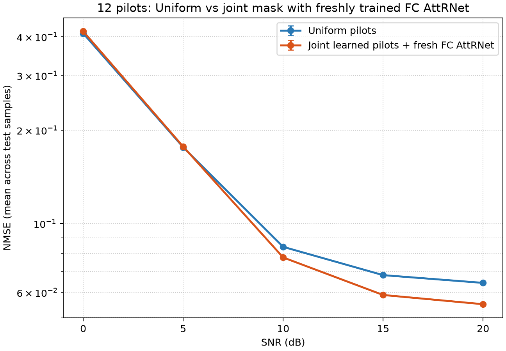
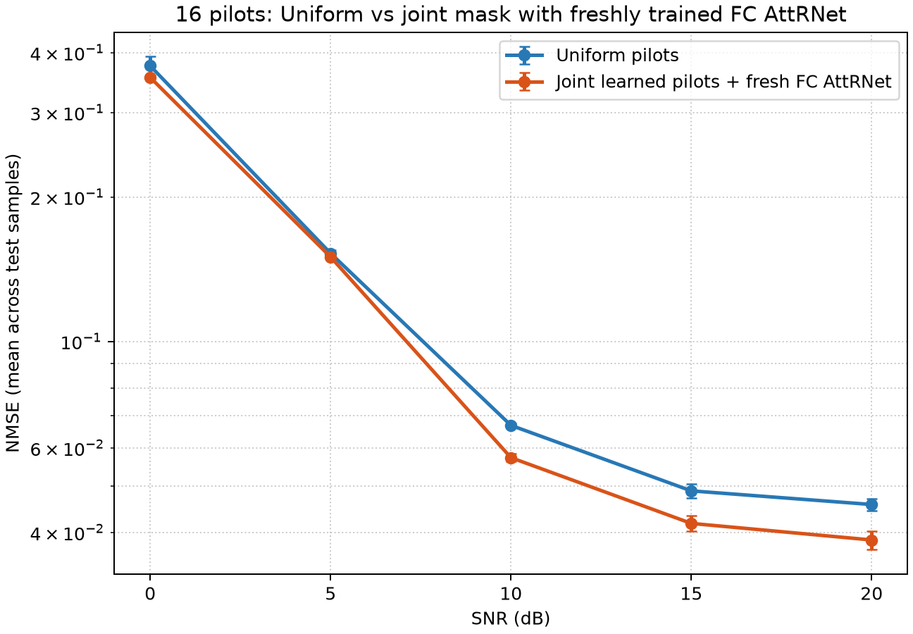
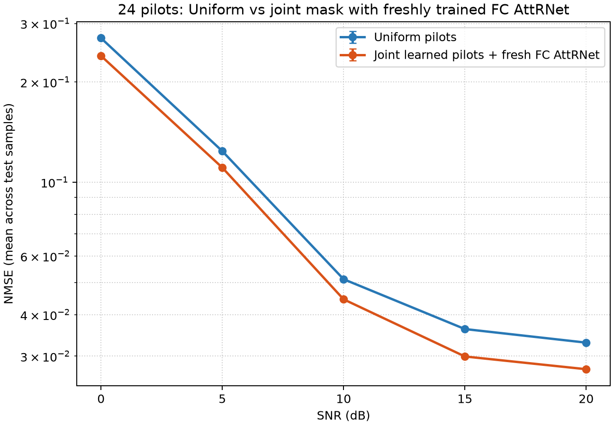
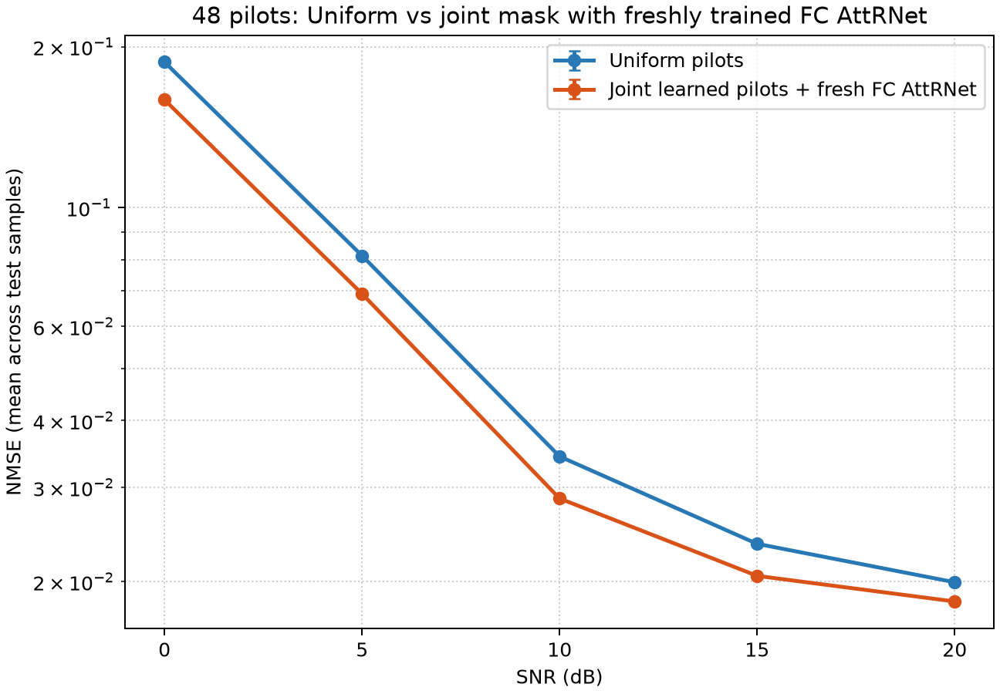
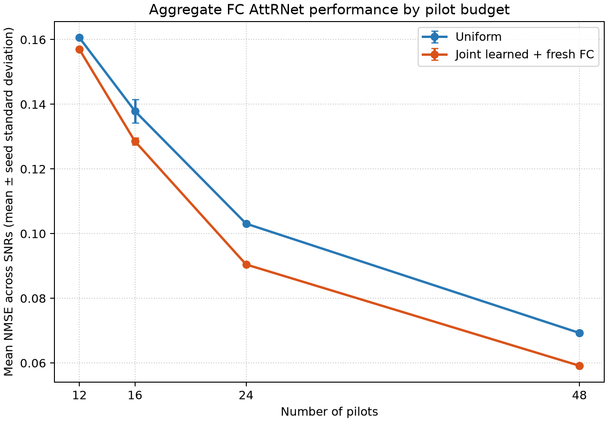
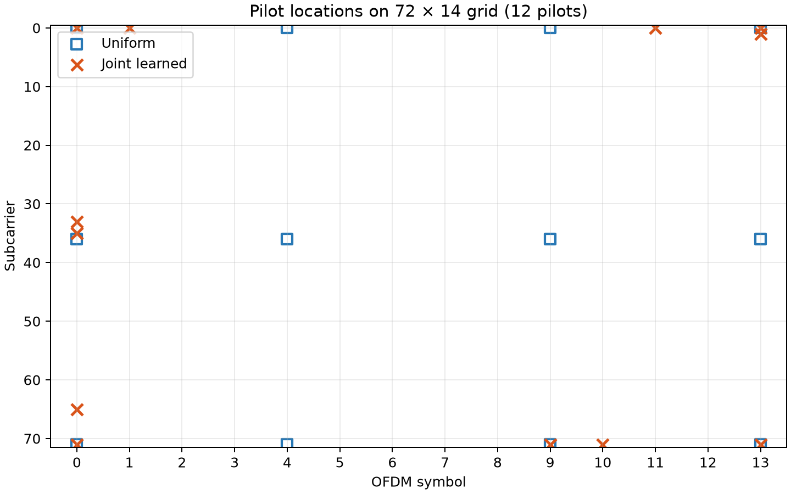
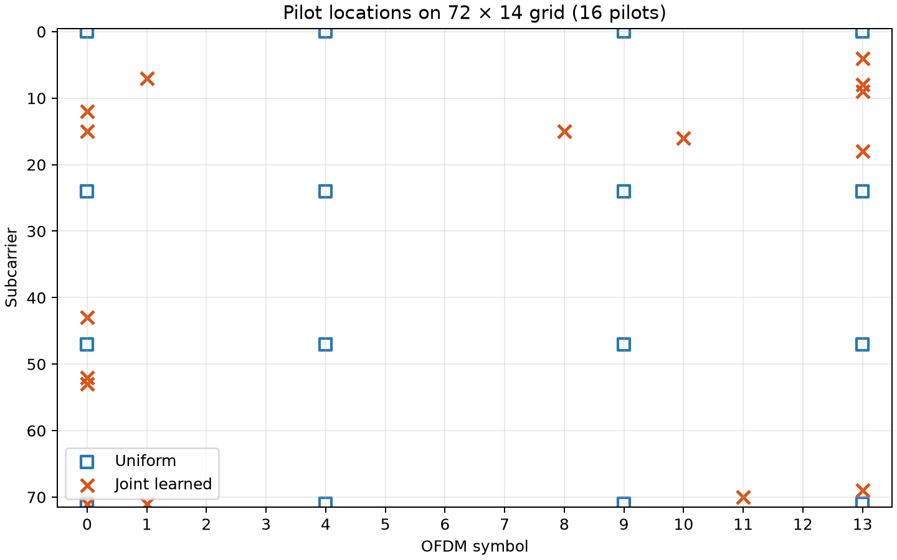
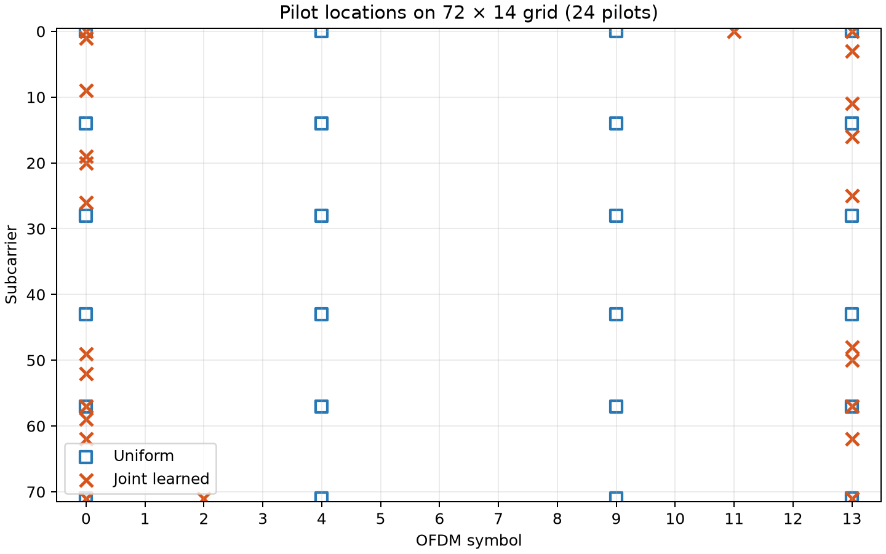
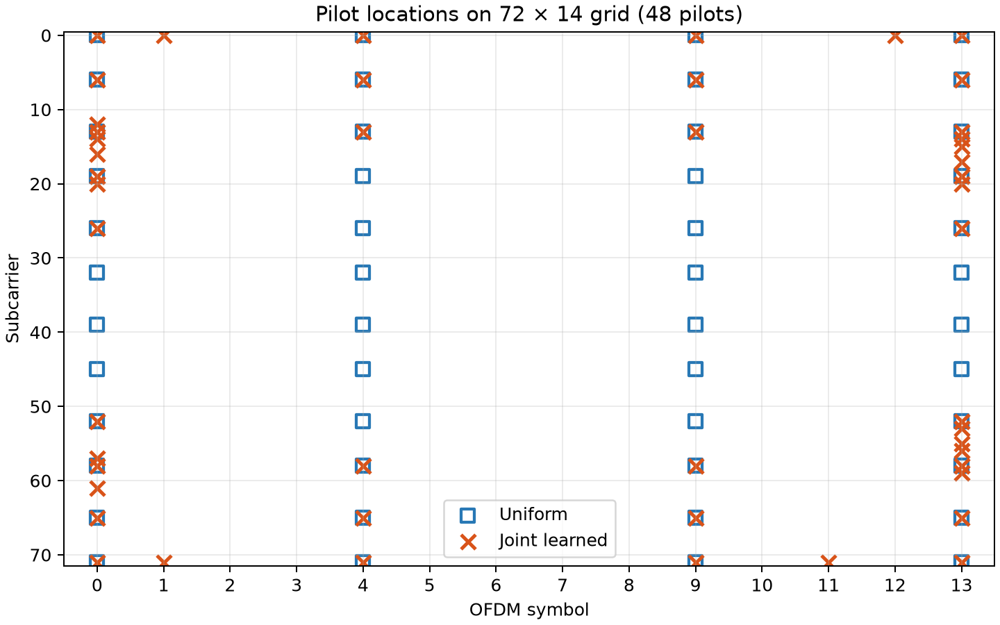
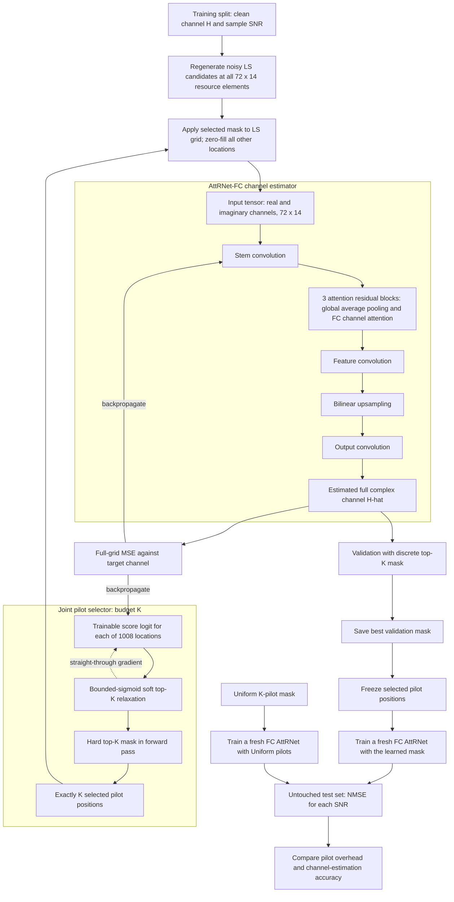

# Deep Learning Based Channel Estimation for OFDM

This project reproduces the AttRNet-Conv and AttRNet-FC channel estimators from Gao et al., *Deep Residual Learning With Attention Mechanism for OFDM Channel Estimation*. It builds MATLAB EPA-OFDM datasets, trains PyTorch models, and compares test-set MSE against approximate values digitized from the paper's plots.

## Progress so far

### AttRNet baseline

The baseline has been trained and evaluated for both attention variants at both pilot counts. The runs use the MATLAB-generated EPA datasets, 100 epochs, Adam with learning rate 0.001, batch size 128, and eight feature channels.

| Pilots | Model | 0 dB | 5 dB | 10 dB | 15 dB | 20 dB |
| ---: | --- | ---: | ---: | ---: | ---: | ---: |
| 24 | AttRNet-FC | 0.0655015 | 0.0255193 | 0.0114817 | 0.00633771 | 0.00449757 |
| 24 | AttRNet-Conv | 0.0655018 | 0.0255239 | 0.0114855 | 0.00634923 | 0.00451102 |
| 48 | AttRNet-FC | 0.0389337 | 0.0161118 | 0.00757006 | 0.00442765 | 0.00313416 |
| 48 | AttRNet-Conv | 0.0389175 | 0.0161130 | 0.00756809 | 0.00442008 | 0.00312695 |

These are test MSE values from the saved runs in `runs/corrected_*`. The expected trend is present: MSE decreases as SNR increases, and the 48-pilot models perform better than the corresponding 24-pilot models. FC and Conv attention perform similarly for a fixed pilot count.

The values are below the paper's approximate digitized values at 0–15 dB and above them at 20 dB for all four configurations. The paper values are readings from Figures 5–6, not tabulated source data. This remaining mismatch is a replication discrepancy, not evidence of improved performance. The original authors' dataset and exact pilot locations are unavailable, and simulation, noise, target, and preprocessing details may differ. See [`paper_vs_simulation_metrics.csv`](paper_vs_simulation_metrics.csv) for the point-by-point reference, relative differences, and checkpoint paths.

#### MSE-versus-SNR plots

Each plot compares the paper's digitized MSE values (dashed) with this project's test-set MSE (solid) at each SNR.

**24 pilots — AttRNet-FC**


**24 pilots — AttRNet-Conv**


**48 pilots — AttRNet-FC**


**48 pilots — AttRNet-Conv**


### Pilot-overhead study: Uniform vs joint learned pilots

All four pilot budgets have now been evaluated with AttRNet-FC. The learned layout is obtained by jointly training a pilot selector and an FC estimator; that discrete mask is then frozen, and a fresh FC estimator is trained from scratch. Uniform and learned masks therefore receive the same fresh-estimator protocol. The 16-pilot case uses three estimator seeds; 12, 24, and 48 pilots use seed 2025.

The table reports NMSE averaged equally over the five test SNRs (0, 5, 10, 15, and 20 dB). Each test SNR has 800 examples. Lower is better.

| Pilots | Overhead | Uniform mean NMSE | Joint-mask mean NMSE | Reduction vs Uniform |
| ---: | ---: | ---: | ---: | ---: |
| 12 | 1.19% | 0.160574 | 0.156954 | 2.25% |
| 16 | 1.59% | 0.137874 | 0.128526 | 6.78% |
| 24 | 2.38% | 0.103082 | 0.090452 | 12.25% |
| 48 | 4.76% | 0.069275 | 0.059138 | 14.63% |

The joint-mask mean is lower at every budget. At 12 pilots, however, it is slightly worse than Uniform at 0 and 5 dB; its improvement is at 10 to 20 dB. Results for 12, 24, and 48 pilots are single-seed comparisons. The 16-pilot results average three seeds and are retained as the reproducibility check. Treat the other gains as promising results that still need repeated-seed confirmation.

#### NMSE versus SNR

Error bars show sample standard deviation across estimator seeds where multiple seeds were run.









#### Aggregate result across pilot budgets



#### Pilot locations

Blue squares show Uniform pilot positions; orange crosses show the learned joint mask. Axes cover the 72-subcarrier by 14-symbol grid.









#### Pilot-reduction workflow



The selector fits the training split and uses validation NMSE to choose its discrete mask; test data is not loaded during selector training. The fresh estimators are selected by validation MSE and evaluated on the held-out test split. Since imported MATLAB files do not store noisy LS observations at omitted positions, candidate observations are regenerated from saved clean channels using the generator's QPSK/AWGN convention. This is a controlled observation-generation assumption, not a measurement recorded in the original MATLAB files.

Raw per-seed/per-SNR results are in `results/reproducibility_all_budgets.csv`; means and standard deviations are in `results/reproducibility_all_budgets_summary.csv`. The 12-, 24-, and 48-pilot masks are in `results/pilot_indices/joint_*.npy`. The 16-pilot mask and its three-seed candidate checkpoint, config, and test metrics are preserved under `results/candidate_joint_16/`.

### Next work

- Optional follow-up: measure seed-to-seed variability for the completed 12-, 24-, and 48-pilot comparisons.
- Benchmark a lightweight residual Transformer with time-frequency position information against AttRNet under matched conditions.
- Explore the IRS-assisted OFDM extension, including cascaded-channel estimation and IRS phase configuration.
- Compare estimation accuracy alongside parameter count, FLOPs, and inference time.

All pilot-budget runs documented above are complete. The remaining bullets are optional follow-up or future research.

## Model and data

The model takes real and imaginary LS pilot estimates as two input channels and predicts the full 72 × 14 complex channel grid. Each attention block uses global average pooling to summarize learned convolution feature maps and produces one attention weight per feature channel; these weights do not correspond directly to individual pilot positions.

The implementation uses a stem convolution, three attention residual blocks, a 3 × 3 feature convolution, bilinear upsampling, and a 36 × 7 output convolution. The paper does not specify padding for the final layer, so this implementation uses same-size asymmetric padding to preserve the 72 × 14 output. AttRNet-FC uses fully connected attention excitation layers; AttRNet-Conv uses 1 × 1 convolutional excitation layers.

The current eight-feature implementation has 10,254 trainable parameters, including the post-block 3 × 3 feature convolution. The mid-semester presentation lists 9,670; reconcile the parameter-count convention and whether that feature convolution was included before using that figure as a paper-matched count.

The MATLAB dataset generator uses `lteFadingChannel` with the 3GPP EPA 7-path profile, 2.5 GHz carrier, 50 km/h motion, and derived maximum Doppler of about 115.82 Hz. Each pilot-count dataset has 20,000 samples split into 12,000 training, 4,000 validation, and 4,000 test samples. SNRs 0, 5, 10, 15, and 20 dB are equally allocated. Pilot coordinates and equal SNR allocation are explicit reproduction choices because the paper does not disclose them.

For details of the generated arrays and assumptions, see [`DATA_GENERATION_README.md`](DATA_GENERATION_README.md) and [`matlab/README.md`](matlab/README.md).

## Reproduce the original paper baselines

These commands reproduce the original AttRNet paper baselines; they are separate from the completed Uniform-versus-joint pilot-overhead experiments above. From this directory, activate a Python environment with the packages in `requirements.txt`. MATLAB datasets and imported NumPy splits for the 24- and 48-pilot baseline are already present in this workspace. To generate 12- or 16-pilot MATLAB datasets, run `generate_epa_ofdm_dataset(12, 'epa7_12pilots_matlab.mat')` or `generate_epa_ofdm_dataset(16, 'epa7_16pilots_matlab.mat')` in MATLAB Online, then import them with:

```powershell
python import_matlab_dataset.py --mat-file epa7_12pilots_matlab.mat --output data/matlab_epa7_12pilots
python import_matlab_dataset.py --mat-file epa7_16pilots_matlab.mat --output data/matlab_epa7_16pilots
```

Alternatively, generate them with the Python simulator:

```powershell
python simulate_data.py --output data/epa7_12pilots --pilots 12
python simulate_data.py --output data/epa7_16pilots --pilots 16
```

To train on either dataset, choose its pilot count and data directory, for example `python train.py --model fc --pilots 12 --data-dir data/matlab_epa7_12pilots --epochs 100 --output runs/fc_12pilots`. The existing baseline commands are:

Train each baseline configuration:

```powershell
python train.py --model fc --pilots 24 --data-dir data/matlab_epa7_24pilots --epochs 100 --output runs/corrected_fc_24
python train.py --model conv --pilots 24 --data-dir data/matlab_epa7_24pilots --epochs 100 --output runs/corrected_conv_24
python train.py --model fc --pilots 48 --data-dir data/matlab_epa7_48pilots --epochs 100 --output runs/corrected_fc_48
python train.py --model conv --pilots 48 --data-dir data/matlab_epa7_48pilots --epochs 100 --output runs/corrected_conv_48
```

Evaluate a checkpoint on the held-out test set and update the CSV. Repeat with each checkpoint and its matching data directory:

```powershell
python evaluate.py --checkpoint runs/corrected_fc_24/best.pt --data-dir data/matlab_epa7_24pilots --split test --comparison-csv paper_vs_simulation_metrics.csv
```

Evaluation prints overall and per-SNR MSE and saves a paper-style log-MSE comparison plot beside the checkpoint. Use `--plot path/to/plot.png` to choose a plot path.

## Repository map

- `attrnet_ofdm/model.py`: AttRNet-FC and AttRNet-Conv architectures.
- `attrnet_ofdm/data.py`: EPA channel/pilot utilities and saved-dataset loader.
- `matlab/generate_epa_ofdm_dataset.m`: MATLAB waveform-level EPA data generator.
- `import_matlab_dataset.py`: converts MATLAB v7.3 files into NumPy splits.
- `train.py` and `evaluate.py`: training, per-SNR test metrics, and paper comparisons.
- `paper_vs_simulation_metrics.csv`: approximate paper references and current baseline test results.
- `runs/corrected_*`: baseline checkpoints, configurations, and comparison plots.
